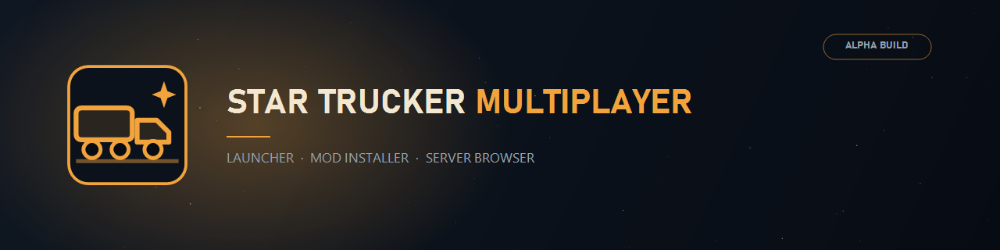
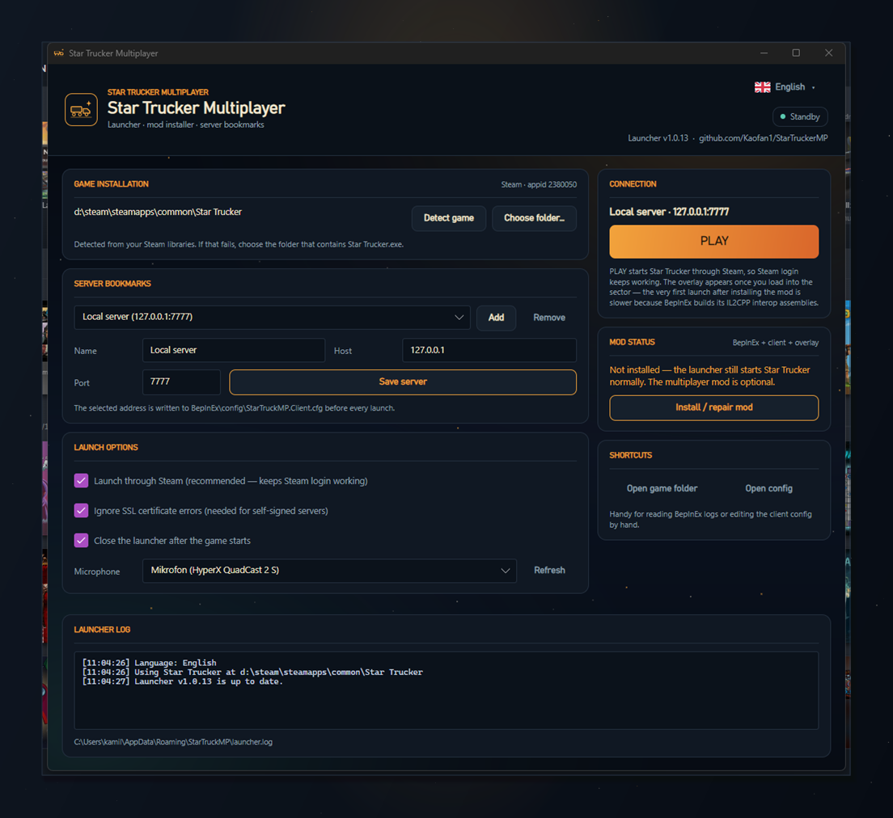

# StarTruckerMP



**English** | [Polski](README.pl.md)

Multiplayer mod for **Star Trucker** on Steam (appid 2380050): synchronized trucks, trailers,
cargo and sector, voice chat over the in-game radio, an in-game overlay and a launcher that
installs the whole thing for you.

> [!CAUTION]
> This is an early alpha build, expect bugs and crashes.
> This is **NOT** intended for production at this point.

Please report bugs and issues in the [Issues](https://github.com/Kaofan1/StarTruckerMP/issues) tab.

## Launcher (recommended)

`StarTruckerMP-Setup.exe` installs the custom launcher, which detects the Steam copy of Star Trucker,
downloads BepInEx + the client, writes the server connection for you and starts the game through Steam
so Steam authentication keeps working.



1. Download `StarTruckerMP-Setup.exe` from [Releases](https://github.com/Kaofan1/StarTruckerMP/releases)
2. Run it - it installs per user, no administrator rights required
3. Open **Star Trucker Multiplayer** from the Start menu
4. Pick a server, press **Install / repair mod**, then **PLAY**

The portable build `StarTruckerMP-Launcher-win-x64.zip` needs no installation at all.
Build steps, file locations and troubleshooting: [docs/launcher/README.en.md](docs/launcher/README.en.md).

## Manual installation (gamers)

The launcher does all of this for you, but the mod can also be installed by hand:

1. Install **BepInEx 6 (IL2CPP, win-x64)** in the game folder - BepInEx 5 (Mono) cannot load this plugin.
2. Unpack `StarTruckerMP-bepinex-plugin-win-x64.zip` from [Releases](https://github.com/Kaofan1/StarTruckerMP/releases)
   into `BepInEx/plugins/StarTruckerMP`.
3. Start the game once so BepInEx builds its interop assemblies.
4. Edit `BepInEx/config/StarTruckerMP.Client.cfg`:

```ini
[Connection]
ServerAddress = 127.0.0.1
ServerPort = 7777

[Audio]
# empty means the system default microphone
MicrophoneDeviceName =

[Security]
IgnoreSslValidation = false
```

> [!NOTE]
> When the plugin is loaded it authenticates with Steam or Xbox Live and connects to the server.
> The launcher writes the server address into that config for you; editing it by hand works too.

## Server hosting

1. Download `StarTruckerMP-server-win-x64.zip` (or the `-linux-x64` build) from Releases and extract it.
2. Install the [.NET 10.0 Runtime](https://dotnet.microsoft.com/download/dotnet/10.0).
3. Run `StarTruckerMP.Server.exe`.

The server creates `server.json` on first start. Set `SteamWebApiKey` to validate Steam tickets,
change `ApiAdminPassword`, and make sure UDP and TCP **7777** are reachable.

> [!CAUTION]
> This is a quick and dirty implementation to get servers up and running. This is **NOT**
> intended for production at this point.

Full guide: [docs/server-hosting/README.md](docs/server-hosting/README.md).

## Developers

Anyone willing to contribute, feel free to jump in.

Project layout, build commands and the CI setup are described in
[docs/development/README.md](docs/development/README.md).

```cmd
:: launcher (portable) -> artifacts\launcher
build-launcher-winx64.cmd

:: launcher + Windows installer -> artifacts\installer\StarTruckerMP-Setup.exe
build-installer-winx64.cmd
```

> [!NOTE]
> The launcher and installer build on a GitHub-hosted Windows runner. Building the client and
> server additionally requires a self-hosted runner with the game interop DLLs - see
> [docs/ci/self-hosted-runner.md](docs/ci/self-hosted-runner.md) (Polish).

## Documentation

| Topic | English | Polski |
| --- | --- | --- |
| Launcher | [README.en.md](docs/launcher/README.en.md) | [README.md](docs/launcher/README.md) |
| Server hosting | [README.md](docs/server-hosting/README.md) | [README.pl.md](docs/server-hosting/README.pl.md) |
| Development | [README.md](docs/development/README.md) | [README.pl.md](docs/development/README.pl.md) |
| CI runner | - | [self-hosted-runner.md](docs/ci/self-hosted-runner.md) |

# Credits

- [JayJay34](https://github.com/JayJay34) - who started the project
- [BepInEx](https://github.com/bepinex/bepinex) - the framework that makes everything possible
- [rnnoise](https://github.com/xiph/rnnoise) - library to reduce noise on PTT
- [RNNoise.Net](https://github.com/Yellow-Dog-Man/RNNoise.Net) - api for .NET to run rnnoise
- [NWaves](https://github.com/ar1st0crat/NWaves) - library used to make DSP in .NET
- [Concentus](https://github.com/lostromb/concentus) - api for .NET to run Opus encoder/decoder
