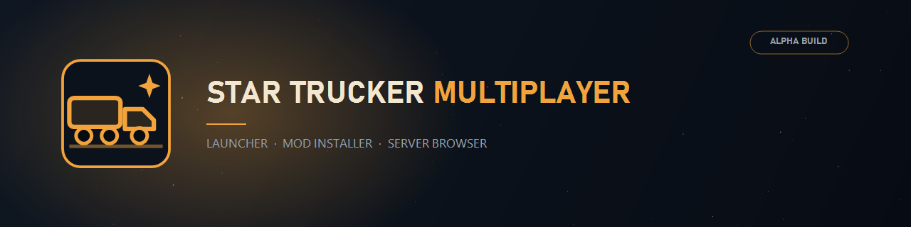
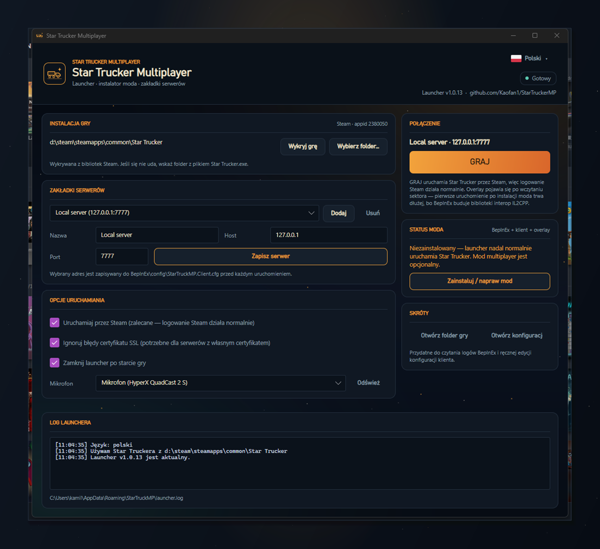

# StarTruckerMP



[English](README.md) | **Polski**

Mod multiplayer do **Star Trucker** ze Steama (appid 2380050): synchronizacja ciężarówek, naczep,
ładunku i sektora, czat głosowy przez radio w grze, overlay w grze oraz launcher, który instaluje
całość za Ciebie.

> [!CAUTION]
> To wczesna wersja alpha, spodziewaj się błędów i crashy.
> To **NIE** jest wersja produkcyjna.

Błędy zgłaszaj w zakładce [Issues](https://github.com/Kaofan1/StarTruckerMP/issues).

## Launcher (zalecany)

`StarTruckerMP-Setup.exe` instaluje launcher, który wykrywa grę ze Steama, pobiera BepInEx i klienta,
zapisuje połączenie z serwerem i uruchamia grę przez Steam, dzięki czemu logowanie SteamWorks działa
normalnie.



1. Pobierz `StarTruckerMP-Setup.exe` z [Releases](https://github.com/Kaofan1/StarTruckerMP/releases).
2. Uruchom go - instaluje się per user, bez uprawnień administratora.
3. Otwórz **Star Trucker Multiplayer** z menu Start.
4. Wybierz serwer, kliknij **Install / repair mod**, a potem **PLAY**.

Wersja portable `StarTruckerMP-Launcher-win-x64.zip` nie wymaga instalacji.
Budowanie, ścieżki plików i rozwiązywanie problemów: [docs/launcher/README.md](docs/launcher/README.md).

## Instalacja ręczna (gracze)

Launcher robi to wszystko sam, ale moda można też wgrać ręcznie:

1. Zainstaluj **BepInEx 6 (IL2CPP, win-x64)** w folderze gry - BepInEx 5 (Mono) nie wczyta tego pluginu.
2. Rozpakuj `StarTruckerMP-bepinex-plugin-win-x64.zip` z [Releases](https://github.com/Kaofan1/StarTruckerMP/releases)
   do `BepInEx/plugins/StarTruckerMP`.
3. Uruchom grę raz, żeby BepInEx wygenerował biblioteki interop.
4. Wyedytuj `BepInEx/config/StarTruckerMP.Client.cfg`:

```ini
[Connection]
ServerAddress = 127.0.0.1
ServerPort = 7777

[Audio]
# puste = domyślny mikrofon systemowy
MicrophoneDeviceName =

[Security]
IgnoreSslValidation = false
```

> [!NOTE]
> Po wczytaniu plugin loguje się przez Steam lub Xbox Live i łączy z serwerem.
> Launcher zapisuje adres serwera do tego pliku, ręczna edycja też działa.

## Hosting serwera

1. Pobierz `StarTruckerMP-server-win-x64.zip` (albo build `-linux-x64`) z Releases i rozpakuj.
2. Zainstaluj [.NET 10.0 Runtime](https://dotnet.microsoft.com/download/dotnet/10.0).
3. Uruchom `StarTruckerMP.Server.exe`.

Serwer tworzy `server.json` przy pierwszym starcie. Ustaw `SteamWebApiKey`, żeby weryfikować bilety
Steama, zmień `ApiAdminPassword` i udostępnij UDP oraz TCP **7777**.

> [!CAUTION]
> To szybka implementacja, żeby serwery w ogóle działały. To **NIE** jest wersja produkcyjna.

Pełny przewodnik: [docs/server-hosting/README.pl.md](docs/server-hosting/README.pl.md).

## Dla developerów

Każdy chętny może dołączyć.

Układ projektu, komendy budowania i CI opisuje
[docs/development/README.pl.md](docs/development/README.pl.md).

```cmd
:: launcher (portable) -> artifacts\launcher
build-launcher-winx64.cmd

:: launcher + instalator -> artifacts\installer\StarTruckerMP-Setup.exe
build-installer-winx64.cmd

:: paczka serwera + ZIP wydania -> artifacts\server-win, StarTruckerMP-server-win-x64.zip
build-server-winx64.cmd
```

> [!NOTE]
> Launcher i instalator budują się na hostowanym runnerze Windows GitHuba. Klient i serwer wymagają
> dodatkowo self-hosted runnera z DLL-ami z gry - patrz
> [docs/ci/self-hosted-runner.md](docs/ci/self-hosted-runner.md).

## Dokumentacja

| Temat | English | Polski |
| --- | --- | --- |
| Launcher | [README.en.md](docs/launcher/README.en.md) | [README.md](docs/launcher/README.md) |
| Hosting serwera | [README.md](docs/server-hosting/README.md) | [README.pl.md](docs/server-hosting/README.pl.md) |
| Development | [README.md](docs/development/README.md) | [README.pl.md](docs/development/README.pl.md) |
| Runner CI | - | [self-hosted-runner.md](docs/ci/self-hosted-runner.md) |

# Podziękowania

- [JayJay34](https://github.com/JayJay34) - zaczął projekt
- [BepInEx](https://github.com/bepinex/bepinex) - framework, bez którego nic by nie działało
- [rnnoise](https://github.com/xiph/rnnoise) - redukcja szumów przy PTT
- [RNNoise.Net](https://github.com/Yellow-Dog-Man/RNNoise.Net) - API .NET do rnnoise
- [NWaves](https://github.com/ar1st0crat/NWaves) - biblioteka DSP w .NET
- [Concentus](https://github.com/lostromb/concentus) - API .NET do enkodera i dekodera Opus
