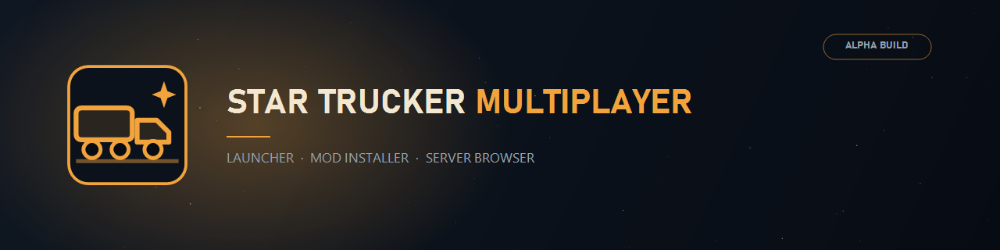
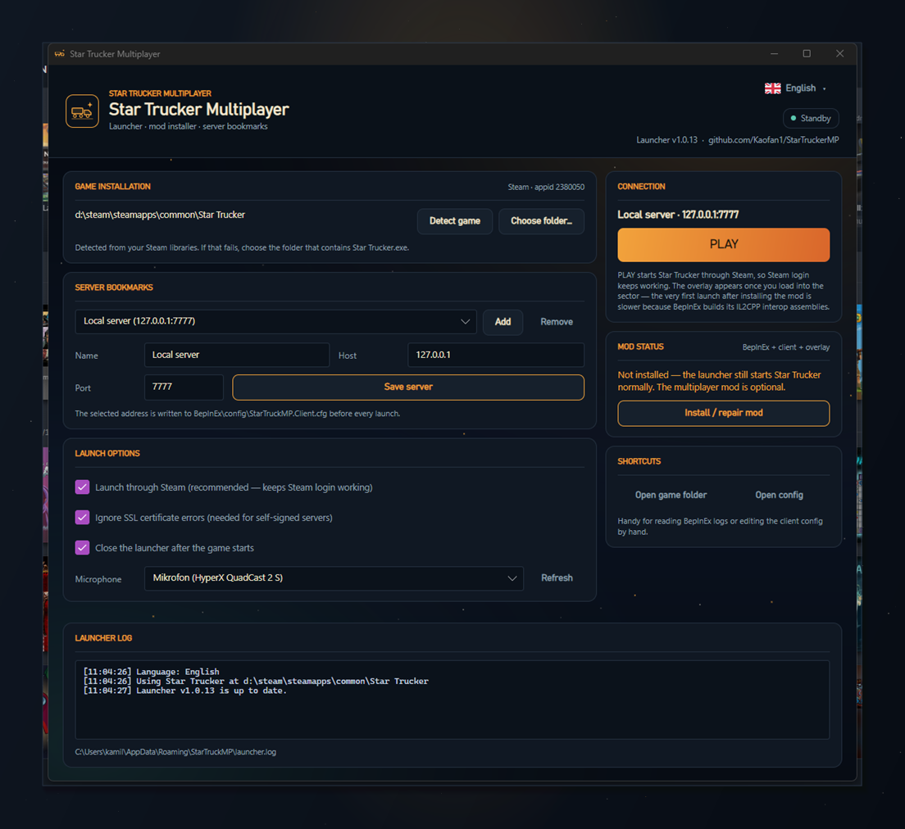

# Star Trucker Multiplayer - launcher and installer

**English** | [Polski](README.md)



The launcher is the main way to install the mod. Instead of copying BepInEx and the plugin by hand,
the player runs a single `StarTruckerMP-Setup.exe` and the launcher does the rest:

1. detects the Steam copy of **Star Trucker** (`appid 2380050`) through the registry, `libraryfolders.vdf`,
   `appmanifest_2380050.acf` and extra Steam libraries,
2. adds **BepInEx 6 (IL2CPP, win-x64)** to the game folder - from the local `payload\bepinex` folder, or from
   [BepInEx Bleeding Edge](https://builds.bepinex.dev/projects/bepinex_be) when that folder is empty
   (stable BepInEx 5 releases only support Mono games and cannot load this plugin),
3. downloads and unpacks the **StarTruckerMP client** into `BepInEx/plugins/StarTruckerMP`,
4. writes the selected server into `BepInEx/config/StarTruckerMP.Client.cfg`,
5. starts the game **through Steam** (`steam://rungameid/2380050`), so SteamWorks login keeps working.



## Installing as a player

1. Download `StarTruckerMP-Setup.exe` from [Releases](https://github.com/Kaofan1/StarTruckerMP/releases).
2. Run it. It installs per user (`%LOCALAPPDATA%\StarTruckerMP`), so no administrator rights are needed.
3. Start **Star Trucker Multiplayer** from the Start menu (the desktop shortcut is optional).
4. Check that the launcher detected the game. If not, click **Choose folder…** and point it at the folder
   containing `Star Trucker.exe`.
5. Add a server (**Add**), type a name, host and port, then save it (**Save server**).
6. Close the game and click **Install / repair mod**. The launcher always downloads a fresh client, so the same
   button repairs a partial installation and updates an old mod version. Wait for "Multiplayer mod is ready.".
7. Click **PLAY**. The game starts through Steam, and the overlay and server connection appear once you enter a sector.

> [!NOTE]
> The first launch after installing the mod takes longer - BepInEx builds its IL2CPP interop assemblies
> (`BepInEx\interop`). If the overlay does not appear the first time, start the game again.
> If the game folder already had BepInEx 5 (Mono), the launcher moves it to `BepInEx.mono-backup-<date>`
> instead of mixing both loaders.

## Languages: English / Polski

The launcher is bilingual. The button in the top right corner of the header shows a flag and the current
language (**🇬🇧 English** or **🇵🇱 Polski**). Clicking it opens a menu with both languages, the active one is
marked with a check. The choice is stored in `%APPDATA%\StarTruckerMP\launcher.json` (field `language`:
`en` or `pl`) and applies to later starts.

Switching the language rebuilds the interface immediately (the launcher reopens in the new language) while
keeping settings, servers and the session log. Technical messages of the mod installer (for example BepInEx
download progress) stay in English.

## Microphone

The **Microphone** field no longer has to be filled in by hand. The launcher reads the recording devices
straight from Windows (winmm/MME - the same names shown in the Windows sound settings) and lists them in a
drop-down:

- **System default (Windows)** - the launcher writes no device name and the client picks the microphone
  itself (the default).
- **a device name** (for example `Mikrofon (HyperX QuadCast 2 S)`) - stored in `[Audio] MicrophoneDeviceName`
  of `StarTruckerMP.Client.cfg`, so the client uses exactly that microphone.

The **Refresh** button reloads the list after plugging or unplugging a microphone while the launcher is
running. The choice is remembered in `launcher.json` (field `microphoneDeviceName`). If the saved device
disappears from the system, the launcher keeps showing it so the choice is not lost, and the client falls
back to the default device when it cannot match the name.

## Update check

On startup the launcher asks GitHub Releases for the latest build (`alpha-v<N>`) and compares it with its own
version. CI builds the launcher as `1.0.<N>`, so the release number and the build number match. When a newer
release exists, an **Update available · Alpha v0.N** button appears under the version in the header and a
**NEW RELEASE** card in the right column shows the changelog taken from the GitHub release description
(headings, bullets and commit links are shortened to fit the narrow column).

Clicking that button updates the launcher without visiting GitHub: it downloads
`StarTruckerMP-Launcher-win-x64.zip` (progress shows in the status pill and the log), closes itself, swaps its
own files in the background and starts the new build. When the launcher folder is not writable (for example a
machine-wide install), the portable zip is replaced by `StarTruckerMP-Setup.exe` running silently
(`/SILENT`), which also swaps the files after the window closed.

The check repeats every 5 minutes while the window is open, so a new release shows up without closing and
reopening the launcher. The check is silent: no internet or a GitHub API rate limit only adds a line to the log
(`Update check skipped: …`) and never blocks the launcher or the game.

## The launcher works on its own, BepInEx is optional

The launcher does not require BepInEx and does not touch the game folder until you click
**Install / repair mod**. Without the mod, **PLAY** simply starts Star Trucker through Steam.

BepInEx also has its own card in the launcher (**BEPINEX LOADER**): it shows whether BepInEx 6 IL2CPP,
BepInEx 5 (Mono) or nothing is in the game folder, and **Install / repair BepInEx** installs only the
loader. That works even when the client package has not been published in a release yet, so the game
can be prepared for plugins independently from the multiplayer mod.

## Local server

The **LOCAL SERVER** card starts and stops the multiplayer server on this PC and shows its state
(running with a PID, stopped, files missing). The state refreshes every 3 seconds, so a server
started outside the launcher shows up too.

The server is looked up in `payload\server` next to the launcher (offline); when that folder is
missing, the launcher downloads `StarTruckerMP-server-win-x64.zip` from GitHub Releases and
extracts it to `%APPDATA%\StarTruckerMP\server`. `server.json` and the certificate live there as
well; the server itself listens on `https://0.0.0.0:7777` and prints its log in a console window.

The launcher also keeps that package current: on start it compares the tag stored in
`package-tag.txt` with the newest release and replaces the server files, leaving `server.json`, the
certificate and the logs alone. While the server runs the update waits for its next start, because
Windows keeps the executable locked.

BepInEx is a separate component (`StarTruckerMP.Launcher/Mod/`) with its own file folder:

| Path | Contents |
| --- | --- |
| `%LOCALAPPDATA%\StarTruckerMP\payload\bepinex` | optional offline payload: unpacked BepInEx files (`winhttp.dll`, `doorstop_config.ini`, `BepInEx\`, `dotnet\`) or a single `.zip` |
| `<game>\BepInEx` | the loader, only after the mod is installed - BepInEx files go nowhere else |

When `payload\bepinex` is empty, the launcher downloads the latest IL2CPP build from builds.bepinex.dev.
That keeps the installer small and free of BepInEx files, while still working fully offline when you put a
payload into that folder.

The installer file name never contains a version number - it is always `StarTruckerMP-Setup.exe`.

## Upgrading from the old name

Earlier builds were called `StarTruckMP`. On the first start after the rename the launcher copies
`%APPDATA%\StarTruckMP\launcher.json` into the new folder, so servers, language, launch options and
window geometry survive the update. The old folder is left untouched. When the mod is installed or
repaired, a leftover `BepInEx/config/StarTruckMP.Client.cfg` is moved to `StarTruckerMP.Client.cfg`
(keeping values the launcher does not manage, such as the radio gain) and the old
`BepInEx/plugins/StarTruckMP` folder is removed so the mod never loads twice.

## What the launcher writes and where

| File | Meaning |
| --- | --- |
| `%APPDATA%\StarTruckerMP\launcher.json` | server list, game path, launch options, language, window size and position |
| `%APPDATA%\StarTruckerMP\launcher.log` | launcher log (useful when reporting bugs) |
| `%APPDATA%\StarTruckerMP\launcher-crash.log` | exception dump when the launcher fails to start |
| `<game>\BepInEx\config\StarTruckerMP.Client.cfg` | server address and port, microphone, `IgnoreSslValidation` |

The launcher does not overwrite other settings in the `.cfg` file - it only changes the keys it owns.

## Requirements

- Windows 10/11 x64
- Star Trucker on **Steam** (the Xbox / Game Pass version is not supported by BepInEx IL2CPP)
- Steam running and signed in (the server validates the Steam ticket)

Portable build: unpack `StarTruckerMP-Launcher-win-x64.zip` anywhere and run
`StarTruckerMP.Launcher.exe`. The build is self-contained and needs no .NET installation.

## Building from source

Requirements: .NET 10 SDK, optionally [Inno Setup 6](https://jrsoftware.org/isdl.php) for the installer.

```cmd
:: launcher only (portable) -> artifacts\launcher
build-launcher-winx64.cmd

:: launcher + installer -> artifacts\installer\StarTruckerMP-Setup.exe
build-installer-winx64.cmd
```

Running the installer compiler by hand:

```cmd
"C:\Program Files (x86)\Inno Setup 6\ISCC.exe" installer\StarTruckerMP.iss
```

The installer metadata version comes from a `#define` (default `1.0.0`):

```cmd
ISCC.exe /DMyAppVersion=1.2.0 installer\StarTruckerMP.iss
```

## Troubleshooting

| Symptom | What to do |
| --- | --- |
| "Star Trucker was not found" | Click **Choose folder…** and point it at the folder with `Star Trucker.exe` (for example `…\steamapps\common\Star Trucker`). |
| Mod installation fails to download | Check access to `api.github.com`, `github.com` and `builds.bepinex.dev` (proxy/firewall). The GitHub API allows 60 requests per hour per IP address. |
| Launcher says "BepInEx 5 (Mono) is installed here" | The game folder had BepInEx 5, which cannot load IL2CPP. Click **Install / repair mod** - the launcher moves the old loader aside and installs BepInEx 6 IL2CPP. |
| The first game start takes minutes | That is normal: BepInEx builds `BepInEx\interop`. Later starts are fast. |
| The game starts but does not connect | Check the server address and port; for your own server with a self-signed certificate keep **Ignore SSL certificate errors** enabled. |
| The overlay does not appear | Close the game, click **Install / repair mod** (it fills in a missing overlay), check `BepInEx\LogOutput.log`. |
| The launcher does not start | Look at `%APPDATA%\StarTruckerMP\launcher-crash.log`. |

## Uninstalling

- The installer removes the launcher, shortcuts and `%APPDATA%\StarTruckerMP`.
- Mod files in the game folder are removed by hand: `winhttp.dll`, `doorstop_config.ini`, `.doorstop_version`
  and the `BepInEx` folder (deleting `winhttp.dll` alone is enough to start the game without the mod).
