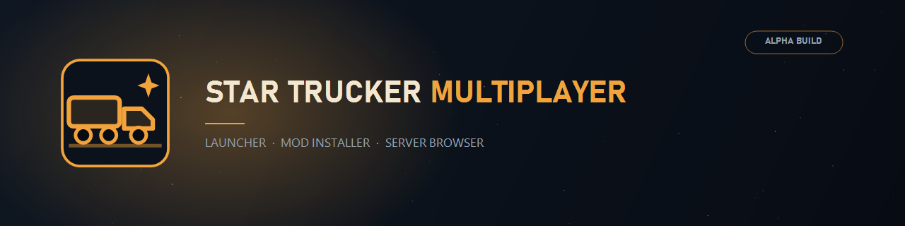
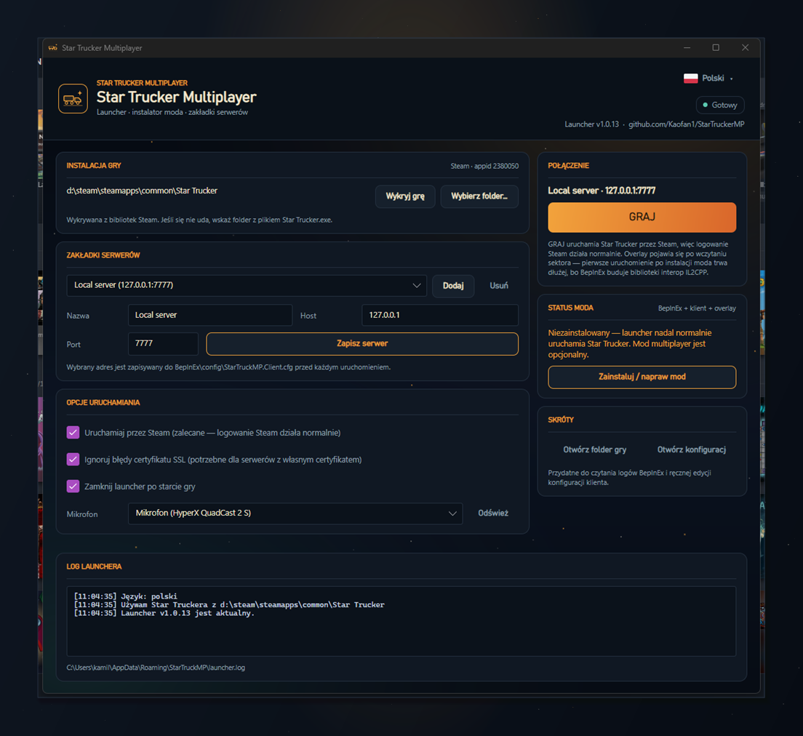

# Star Trucker Multiplayer - launcher i instalator

[English](README.en.md) | **Polski**



Launcher jest teraz głównym sposobem instalacji moda. Zamiast ręcznego kopiowania BepInEx i pluginu,
gracz uruchamia jeden plik `StarTruckerMP-Setup.exe`, a launcher robi resztę:

1. wykrywa zainstalowaną przez Steam grę **Star Trucker** (`appid 2380050`) - rejestr, `libraryfolders.vdf`, `appmanifest_2380050.acf`, dodatkowe biblioteki Steam,
2. dokłada **BepInEx 6 (IL2CPP, win-x64)** do folderu gry - z lokalnego payloadu `payload\bepinex`, a gdy jest pusty,
   z [BepInEx Bleeding Edge](https://builds.bepinex.dev/projects/bepinex_be)
   (stabilne wydania BepInEx 5 obsługują wyłącznie gry Mono - nie potrafią wczytać tego pluginu),
3. pobiera i rozpakowuje **klienta StarTruckerMP** do `BepInEx/plugins/StarTruckerMP`,
4. zapisuje wybrany serwer do `BepInEx/config/StarTruckerMP.Client.cfg`,
5. uruchamia grę **przez Steam** (`steam://rungameid/2380050`), dzięki czemu logowanie SteamWorks działa normalnie.



## Instalacja dla gracza

1. Pobierz `StarTruckerMP-Setup.exe` z zakładki [Releases](https://github.com/Kaofan1/StarTruckerMP/releases).
2. Uruchom instalator. Instaluje się **per-user** (`%LOCALAPPDATA%\StarTruckerMP`), więc nie wymaga uprawnień administratora.
3. Uruchom **Star Trucker Multiplayer** z menu Start (skrót na pulpicie jest opcjonalny).
4. Sprawdź, czy launcher poprawnie wykrył grę. Jeśli nie - kliknij **Choose folder…** i wskaż katalog z `Star Trucker.exe`.
5. Dodaj serwer (**Add**), wpisz nazwę, host i port, zapisz (**Save server**).
6. Zamknij grę i kliknij **Zainstaluj** w karcie **STATUS MODA**. Ten przycisk uzupełnia tylko brakujące
   elementy; **Napraw mod** usuwa folder pluginu i wgrywa klienta od nowa, a **Odinstaluj** usuwa moda
   z folderu gry. Poczekaj na komunikat „Multiplayer mod is ready.”.
7. Kliknij **PLAY**. Gra wystartuje przez Steam, a po wejściu do sektora pojawi się overlay i połączenie z serwerem.

> [!NOTE]
> Pierwsze uruchomienie po instalacji moda trwa dłużej - BepInEx generuje wtedy biblioteki interop dla IL2CPP
> (katalog `BepInEx\interop`). Jeśli overlay nie pojawi się za pierwszym razem, uruchom grę ponownie.
> Jeśli w folderze gry był wcześniej BepInEx 5 (Mono), launcher przenosi go do `BepInEx.mono-backup-<data>`
> zamiast mieszać oba loadery.

## Języki: English / Polski

Launcher jest dwujęzyczny. W prawym górnym roku nagłówka znajduje się przycisk z flagą i nazwą
aktualnie wybranego języka (**🇬🇧 English** lub **🇵🇱 Polski**). Kliknięcie otwiera menu z oba językami,
a bieżący jest oznaczony ptaszkiem. Wybór jest zapisywany w `%APPDATA%\StarTruckerMP\launcher.json`
(pole `language`: `en` lub `pl`) i obowiązuje przy kolejnych startach.

Zmiana języka przebudowuje interfejs od razu (launcher otwiera się ponownie w nowym języku),
zachowując ustawienia, serwery i log sesji. Komunikaty techniczne instalatora moda (np. postęp
pobierania BepInEx) pozostają po angielsku.

## Mikrofon

Pola **Mikrofon** nie trzeba już wypełniać ręcznie. Launcher odczytuje listę urządzeń nagrywających
prosto z Windows (winmm/MME - te same nazwy, które widać w ustawieniach dźwięku) i pokazuje ją
w rozwijanej liście:

- **Domyślne urządzenie systemowe** - launcher nie zapisuje nazwy, a klient sam wybiera mikrofon
  (ustawienie domyślne).
- **nazwa urządzenia** (np. `Mikrofon (HyperX QuadCast 2 S)`) - trafia do `[Audio] MicrophoneDeviceName`
  w `StarTruckerMP.Client.cfg`, więc klient użyje dokładnie tego mikrofonu.

Przycisk **Odśwież** odświeża listę po podłączeniu lub odłączeniu mikrofonu w trakcie działania launchera.
Wybór jest pamiętany w `launcher.json` (pole `microphoneDeviceName`). Jeśli zapisane urządzenie zniknie
z systemu, launcher nadal pokazuje je na liście, żeby wybór nie przepadł, a klient przy braku dopasowania
sam przechodzi na domyślne urządzenie.

## Sprawdzanie aktualizacji

Przy starcie launcher pyta GitHub Releases o najnowsze wydanie (`alpha-v<N>`) i porównuje je z własną wersją.
CI buduje launcher jako `1.0.<N>`, więc numer wydania i numer builda są zgodne. Gdy dostępne jest nowsze
wydanie, pod numerem wersji w nagłówku pojawia się przycisk **Dostępna aktualizacja · Alpha v0.N**,
a w prawej kolumnie karta **NOWA WERSJA** z listą zmian przepisaną z opisu wydania na GitHubie
(nagłówki, punkty i linki do commitów są skrócone, żeby zmieściły się w wąskiej kolumnie).

Kliknięcie tego przycisku aktualizuje launcher bez odwiedzania GitHuba: launcher pobiera paczkę
`StarTruckerMP-Launcher-win-x64.zip` (postęp widać w pasku statusu i w logu), zamyka się, podmienia własne
pliki w tle i uruchamia nową wersję. Gdy folder launchera nie jest zapisywalny (np. instalacja dla całego
systemu), zamiast paczki przenośnej pobierany jest `StarTruckerMP-Setup.exe` i uruchamiany cicho
(`/SILENT`), także z podmianą plików po zamknięciu okna.

Sprawdzenie powtarza się co 5 minut, dopóki okno jest otwarte, więc nowe wydanie pojawia się bez zamykania
i ponownego uruchamiania launchera. Sprawdzenie jest ciche: brak internetu lub limit GitHub API kończy się
wpisem w logu (`Pominięto sprawdzanie aktualizacji: …`) i nie blokuje startu ani gry.

## Launcher działa samodzielnie, BepInEx jest opcjonalny

Launcher nie wymaga BepInEx i nie dotyka folderu gry, dopóki nie klikniesz **Zainstaluj**.
Bez moda przycisk **PLAY** po prostu uruchamia Star Trucker przez Steam.

BepInEx ma też własną kartę w launcherze (**LOADER BEPINEX**): pokazuje, czy w folderze gry jest
BepInEx 6 IL2CPP, BepInEx 5 (Mono), czy nic, a przyciski **Zainstaluj**, **Napraw loader** i **Odinstaluj**
działają wyłącznie na loaderze i nie ruszają pluginu moda. **Odinstaluj** w obu kartach najpierw pyta
o potwierdzenie, więc przypadkowe kliknięcie nie usuwa plików z folderu gry. Działa to nawet wtedy,
gdy paczka klienta nie została jeszcze opublikowana w wydaniu, więc
grę można przygotować pod pluginy niezależnie od moda multiplayer.

## Mody BepInEx

Karta **MODY BEPINEX** pokazuje, co leży w `BepInEx\plugins`, i pozwala dorzucić własne mody:
**Dodaj moda…** przyjmuje pojedynczy plik `.dll` albo archiwum `.zip` (np. paczkę moda z jego
folderem) i kopiuje je do `BepInEx\plugins`, nadpisując tylko pliki o tych samych nazwach.
**Otwórz folder pluginów** otwiera ten katalog w Eksploratorze, a **Odśwież** przeczesuje go
ponownie po ręcznych zmianach. Kliknięcie wiersza zaznacza plugin, a **Usuń zaznaczony** usuwa go
po potwierdzeniu w oknie dialogowym. **Wyłącz** odsuwa plugin bez kasowania plików: luźny `.dll`
dostaje rozszerzenie `.disabled`, a folder pluginu przenosi się do `BepInEx\plugins-disabled`.
Potem ten sam przycisk zmienia się w **Włącz** i przywraca plugin na miejsce. Wpis „nasz klient”
to plugin StarTruckerMP i jego nie da się tu usunąć ani wyłączyć (służy do tego **Odinstaluj**
w karcie STATUS MODA).

## Wyszukiwarka serwerów dedykowanych

Karta **SERWERY DEDYKOWANE** czyta publiczny katalog serwerów. Podaj host i port serwera, który ten
katalog hostuje, wpisz nazwę lub host w polu szukania i kliknij **Szukaj** albo naciśnij Enter.
Wyniki są tabelą jak w przeglądarce serwerów: nazwa, gracze i ping mierzony przez launcher, a kliknięcie
nagłówka sortuje według tej kolumny (drugie kliknięcie odwraca kolejność). Ping po pierwszym kliknięciu
pokazuje najlepsze łącza, po drugim najgorsze. Kliknij serwer dwukrotnie, żeby zapisać go w zakładkach
i móc kliknąć **GRAJ**.

Host i port katalogu są zapamiętywane w `launcher.json`, więc wystarczy wpisać je raz. Katalog może
działać na certyfikacie self-signed, bo launcher czyta wyłącznie publiczne dane; gdy https nie
odpowie, próbuje jeszcze http. Sam katalog hostuje dowolny serwer StarTruckerMP, opis endpointów
jest w [dokumentacji hostingu](../server-hosting/README.pl.md).

## Lokalny serwer

Karta **SERWER LOKALNY** uruchamia i zatrzymuje serwer multiplayera na tym komputerze oraz
pokazuje jego stan (działa z PID-em, zatrzymany, brak plików). Stan odświeża się co 3 sekundy,
więc widać też serwer uruchomiony poza launcherem.

Serwer jest szukany w `payload\server` obok launchera (offline), a gdy tego folderu nie ma,
launcher pobiera `StarTruckerMP-server-win-x64.zip` z GitHub Releases i rozpakowuje go do
`%APPDATA%\StarTruckerMP\server`. Tam też trafiają `server.json` i certyfikat; sam serwer
działa na `https://localhost:7777` i pisze log do `server-out.log` oraz `server-err.log` w tym
folderze, więc nie otwiera osobnego okna konsoli. Gdy serwer działa, karta pokazuje adres strony
statusu, a **Zatrzymaj serwer** kończy proces.

Launcher sam pilnuje też aktualności tej paczki: przy starcie porównuje tag zapisany w
`package-tag.txt` z najnowszym wydaniem i podmienia pliki serwera, zostawiając `server.json`,
certyfikat i logi. Gdy serwer działa, aktualizacja czeka do następnego uruchomienia, bo Windows
trzyma jego plik exe zablokowany.

BepInEx jest osobnym komponentem (`StarTruckerMP.Launcher/Mod/`) z własnym folderem plików:

| Ścieżka | Zawartość |
| --- | --- |
| `%LOCALAPPDATA%\StarTruckerMP\payload\bepinex` | opcjonalny payload offline: rozpakowane pliki BepInEx (`winhttp.dll`, `doorstop_config.ini`, `BepInEx\`, `dotnet\`) albo jeden plik `.zip` |
| `<gra>\BepInEx` | loader dopiero po instalacji moda - tylko tutaj trafiają pliki BepInEx |

Gdy `payload\bepinex` jest pusty, launcher pobiera najnowszy build IL2CPP z builds.bepinex.dev.
Dzięki temu instalator jest lekki i nie zawiera plików BepInEx, a mimo to działa w pełni offline,
jeśli włożysz payload do tego folderu.

Nazwa pliku instalatora nie zawiera numeru wersji - zawsze jest to `StarTruckerMP-Setup.exe`.

## Aktualizacja ze starej nazwy

Wcześniejsze buildy nazywały się `StarTruckMP`. Przy pierwszym starcie po zmianie nazwy launcher kopiuje
`%APPDATA%\StarTruckMP\launcher.json` do nowego folderu, więc serwery, język, opcje startu i geometria
okna przetrwają aktualizację. Stary folder zostaje nietknięty. Przy instalacji lub naprawie moda launcher
przenosi pozostały `BepInEx/config/StarTruckMP.Client.cfg` do `StarTruckerMP.Client.cfg` (zachowując
wartości, których nie zarządza, np. wzmocnienie radia) i usuwa stary folder `BepInEx/plugins/StarTruckMP`,
żeby mod nie wczytywał się dwa razy.

## Co launcher zapisuje i gdzie

| Plik | Znaczenie |
| --- | --- |
| `%APPDATA%\StarTruckerMP\launcher.json` | lista serwerów, ścieżka do gry, ustawienia startu, język, rozmiar i pozycja okna |
| `%APPDATA%\StarTruckerMP\launcher.log` | log launchera (przydatny przy zgłaszaniu błędów) |
| `%APPDATA%\StarTruckerMP\launcher-crash.log` | zapis wyjątku, jeśli launcher nie wystartuje |
| `<gra>\BepInEx\config\StarTruckerMP.Client.cfg` | adres/port serwera, mikrofon, `IgnoreSslValidation` |

Launcher nie nadpisuje pozostałych ustawień w pliku `.cfg` - zmienia tylko klucze, którymi zarządza.

## Wymagania

- Windows 10/11 x64
- Star Trucker w wersji **Steam** (wersja Xbox / Game Pass nie jest wspierana przez BepInEx IL2CPP)
- Steam uruchomiony i zalogowany (do weryfikacji biletu Steam na serwerze)

Wersja portable: rozpakuj `StarTruckerMP-Launcher-win-x64.zip` w dowolne miejsce i uruchom
`StarTruckerMP.Launcher.exe`. Build jest self-contained, nie wymaga instalacji .NET.

## Budowanie ze źródeł

Wymagania: .NET 10 SDK, opcjonalnie [Inno Setup 6](https://jrsoftware.org/isdl.php) do instalatora.

```cmd
:: sam launcher (portable) -> artifacts\launcher
build-launcher-winx64.cmd

:: launcher + instalator -> artifacts\installer\StarTruckerMP-Setup.exe
build-installer-winx64.cmd
```

Ręczne wywołanie kompilatora instalatora:

```cmd
"C:\Program Files (x86)\Inno Setup 6\ISCC.exe" installer\StarTruckerMP.iss
```

Wersja w metadanych instalatora jest przekazywana przez `#define` (domyślnie `1.0.0`):

```cmd
ISCC.exe /DMyAppVersion=1.2.0 installer\StarTruckerMP.iss
```

## Rozwiązywanie problemów

| Objaw | Co zrobić |
| --- | --- |
| „Star Trucker was not found” | Kliknij **Choose folder…** i wskaż katalog z `Star Trucker.exe` (np. `…\steamapps\common\Star Trucker`). |
| Instalacja moda kończy się błędem pobierania | Sprawdź dostęp do `api.github.com`, `github.com` i `builds.bepinex.dev` (proxy/firewall). GitHub API ma limit 60 zapytań na godzinę na adres IP. |
| Launcher: „BepInEx 5 (Mono) is installed here” | W folderze gry był BepInEx 5, który nie obsługuje IL2CPP. Kliknij **Napraw mod** - launcher odsunie stary loader i wgra BepInEx 6 IL2CPP. |
| Pierwszy start gry trwa kilka minut | To normalne: BepInEx buduje `BepInEx\interop`. Kolejne starty są szybkie. |
| Gra startuje, ale nie ma połączenia | Sprawdź port i adres serwera; przy własnym serwerze z certyfikatem self-signed pozostaw włączone **Ignore SSL certificate errors**. |
| Overlay się nie pojawia | Zamknij grę, kliknij **Napraw mod** (uzupełni brakujący overlay), sprawdź `BepInEx\LogOutput.log`. |
| Launcher nie startuje | Zajrzyj do `%APPDATA%\StarTruckerMP\launcher-crash.log`. |

## Odinstalowanie

- Instalator usuwa launcher, skróty oraz `%APPDATA%\StarTruckerMP`.
- Pliki moda w folderze gry usuwa się ręcznie: `winhttp.dll`, `doorstop_config.ini`, `.doorstop_version`, katalog `BepInEx`.
  (Usunięcie `winhttp.dll` wystarcza, żeby gra startowała bez moda.)
